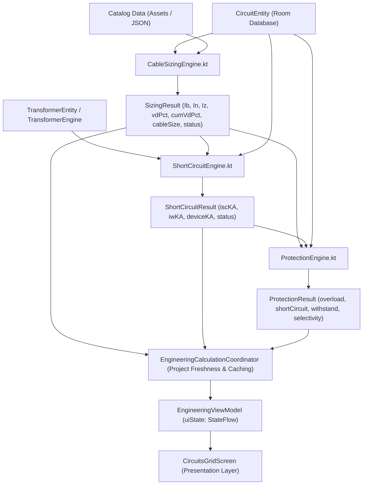

# VoltAtlas Circuits Screen: Comprehensive Current-State, Data-Reconciliation, UX, and Redesign-Readiness Audit

**Document:** `CIRCUITS_SCREEN_CURRENT_STATE_AND_REDESIGN_READINESS_AUDIT.md`  
**Execution Mode:** AUDIT ONLY (No production code, entity, engine, or UI modifications executed)  
**Target Module:** Circuits List (`CircuitsGridScreen.kt`) and directly connected Circuit details / edit / schedule flows  
**Audit Date:** August 26, 2026  
**Engineering Environment:** Android / Jetpack Compose / Material Design 3 / Room SQLite / Kotlin Coroutines & StateFlow  

---

## 1. Executive Verdict

### 1.1 Overall Readiness Status
**Verdict:** `READY FOR PHASED REDESIGN, PENDING PRODUCT-OWNER APPROVAL`

### 1.2 Executive Summary
A comprehensive, line-by-line inspection of the VoltAtlas Android codebase demonstrates that the application possesses an authoritative, deterministic data and calculation pipeline capable of supporting the approved visual and UX direction. Every core engineering metric presented in the proposal—including design current ($I_b$), device rating ($I_n$), derated cable ampacity ($I_z$), voltage drop percentage ($V_d\,\%$) and volts ($V_d\,\text{V}$), cumulative voltage drop ($V_{d,\text{cum}}\,\%$), thermal withstand / loading utilization ($I_b / I_z$), 3-phase symmetrical short-circuit current ($I_{sc(3\Phi)}$), device breaking capacity ($I_{cu}$), and cable cross-section ($S\,\text{mm}^2$)—is actively calculated by deterministic engines (`CableSizingEngine`, `ShortCircuitEngine`, `ProtectionEngine`, `CircuitChildLookup`) and delivered via `UiState.Success`.

However, the existing UI layer (`CircuitsGridScreen.kt`) represents a legacy Phase 1/2 implementation that suffers from several structural and UX deficiencies:
1. **Outdated Card Layout & Tokens**: Uses raw `Card` containers with explicit `BorderStroke(1.dp)` and legacy theme colors (`ThemeBorderSubtle`, `ThemePrimary`, `DarkBackground`) instead of the unified Material Design 3 `surfaceContainer`-driven Design System tokens (`DsCard`, `DsMetricTile`, `DsStatusBadge`, `DsSelectableChip`, `DsFab`).
2. **Missing High-Level Engineering Summary**: Does not display an aggregated project/list health summary strip (Total circuits, Pass, Warning, Fail, Maximum Voltage Drop).
3. **Absence of Sorting & Count Controls**: Lacks circuit count indicators and list sorting mechanisms (Sort by Name, Load, Status, Tier).
4. **Information Overcrowding in Expanded State**: Inlines full override editing forms into the LazyColumn items, triggering excessive vertical sprawl and nested dropdown menus inside list cards.
5. **Limited Filter UX**: Uses a cyclic toggling filter chip for Tier (`All` $\rightarrow$ `Transformer` $\rightarrow$ `Sub-feeders`) and Status (`All` $\rightarrow$ `PASS` $\rightarrow$ `WARNING` $\rightarrow$ `FAIL`) rather than a clear, multi-chip selector or bottom sheet filter.

### 1.3 Key Stop-Gate Conditions
- **Zero Engineering Calculation in UI**: Redesign must strictly bind to `UiState.Success.sizingResults`, `UiState.Success.shortCircuitResults`, `UiState.Success.protectionResults`, and precomputed `CircuitChildLookup`.
- **Preserve Data Model & Persistence**: No Room migrations, schema modifications, or entity changes are permitted or required.
- **Progressive Phasing**: Execution must follow the 9-phase blueprint ($R0$ through $R8$) with discrete stop gates.

---

## 2. Scope and Evidence Reviewed

### 2.1 File & Module Inventory
The following source files, test suites, assets, and design system components were audited:

| Component | Exact File Path | Line Count | Responsibility |
|---|---|---|---|
| **Screen Composable** | [`CircuitsGridScreen.kt`](file:///e:/voltatlas-v.1%20(4)/app/src/main/java/com/example/ui/screens/CircuitsGridScreen.kt) | 811 | Current Circuits screen Composable, LazyColumn, search, filter chips, expandable cards, overrides |
| **Hierarchy Helper** | [`CircuitChildLookup.kt`](file:///e:/voltatlas-v.1%20(4)/app/src/main/java/com/example/ui/screens/CircuitChildLookup.kt) | 74 | $O(N)$ single-pass immutable lookup for child circuits, parent load sum, and load conflict detection |
| **Edit/Create Flow** | [`CircuitEditDialog.kt`](file:///e:/voltatlas-v.1%20(4)/app/src/main/java/com/example/ui/dialogs/CircuitEditDialog.kt) | 1203 | Modal form for creating and updating `CircuitEntity` instances across 4 electrical sections |
| **Main Navigation Shell** | [`MainLayout.kt`](file:///e:/voltatlas-v.1%20(4)/app/src/main/java/com/example/ui/MainLayout.kt) | 1387 | AppShell container, TopAppBar, NavigationBar (Tab 1 = Circuits), export orchestration, AI sheet |
| **State Orchestrator** | [`EngineeringViewModel.kt`](file:///e:/voltatlas-v.1%20(4)/app/src/main/java/com/example/ui/EngineeringViewModel.kt) | 1030 | `uiState` StateFlow builder, project management, calculation triggers, search query/filter StateFlows |
| **UI State Model** | [`UiState.kt`](file:///e:/voltatlas-v.1%20(4)/app/src/main/java/com/example/ui/UiState.kt) | 76 | Sealed interface (`Loading`, `Error`, `Success`) holding all circuit, sizing, short-circuit, and validation outputs |
| **Domain Entities** | [`Entities.kt`](file:///e:/voltatlas-v.1%20(4)/app/src/main/java/com/example/data/Entities.kt) | 327 | `CircuitEntity`, `TransformerEntity`, `GeneratorEntity`, `AtsEntity`, `UpsEntity`, `ProjectEntity` |
| **Data Models & Catalog** | [`Models.kt`](file:///e:/voltatlas-v.1%20(4)/app/src/main/java/com/example/data/Models.kt) | 575 | `Catalog` loader, `CableType`, `DataSheetEntry`, `CableCatalogEntry`, `BreakerEntry`, `CatalogDiagnostics` |
| **Cable Sizing Engine** | [`CableSizingEngine.kt`](file:///e:/voltatlas-v.1%20(4)/app/src/main/java/com/example/engine/CableSizingEngine.kt) | 941 | IEC 60364-5-52 deterministic cable sizing, derating, voltage drop, neutral/earth sizing, standard ratings |
| **Short-Circuit Engine** | [`ShortCircuitEngine.kt`](file:///e:/voltatlas-v.1%20(4)/app/src/main/java/com/example/engine/ShortCircuitEngine.kt) | 181 | IEC 60909 impedance walk, $I_{sc(3\Phi)}$, $I_p$, thermal withstand $I_w$, device breaking check |
| **Protection Engine** | [`ProtectionEngine.kt`](file:///e:/voltatlas-v.1%20(4)/app/src/main/java/com/example/engine/ProtectionEngine.kt) | 194 | Overload ($I_b \le I_n \le I_z$), short-circuit breaking, $k^2S^2 \ge I^2t$, selectivity ratio check, ADS loop impedance |
| **Hierarchy Resolver** | [`HierarchyResolver.kt`](file:///e:/voltatlas-v.1%20(4)/app/src/main/java/com/example/hierarchy/HierarchyResolver.kt) | 141 | Tree building, level depth computation, cycle detection, parent backfill |
| **Calculation Coordinator** | [`EngineeringCalculationCoordinator.kt`](file:///e:/voltatlas-v.1%20(4)/app/src/main/java/com/example/engine/coordinator/EngineeringCalculationCoordinator.kt) | 1826 | Bulk calculation orchestration, project-scoped caching, freshness tracking |
| **Cable Service Bridge** | [`CableCalculationService.kt`](file:///e:/voltatlas-v.1%20(4)/app/src/main/java/com/example/engine/coordinator/CableCalculationService.kt) | 325 | Typed structured checks (`CableStructuredCheck`), evaluation mapping |
| **Design System Tokens** | [`DsTokens.kt`](file:///e:/voltatlas-v.1%20(4)/app/src/main/java/com/example/ui/designsystem/theme/DsTokens.kt) | 88 | `DsColor`, `DsSpacing`, `DsShape`, `DsShapes` tokens |
| **Design System Theme** | [`DsTheme.kt`](file:///e:/voltatlas-v.1%20(4)/app/src/main/java/com/example/ui/designsystem/theme/DsTheme.kt) | 157 | `DsExtendedColors`, dark/light color schemes, `MaterialTheme.dsExtendedColors` |
| **Design System Cards** | [`DsCard.kt`](file:///e:/voltatlas-v.1%20(4)/app/src/main/java/com/example/ui/designsystem/components/DsCard.kt) | 58 | MD3 `surfaceContainer` card with 1dp tonal elevation, 14dp radius |
| **Design System Metrics** | [`DsMetricTile.kt`](file:///e:/voltatlas-v.1%20(4)/app/src/main/java/com/example/ui/designsystem/components/DsMetricTile.kt) | 76 | Summary KPI tile with label, large value, unit, and status badge |
| **Design System Badges** | [`DsStatusBadge.kt`](file:///e:/voltatlas-v.1%20(4)/app/src/main/java/com/example/ui/designsystem/components/DsStatusBadge.kt) | 94 | Pill status badge with 15% tinted alpha container, full-saturation text and dot |
| **Design System FAB** | [`DsFab.kt`](file:///e:/voltatlas-v.1%20(4)/app/src/main/java/com/example/ui/designsystem/components/DsFab.kt) | 49 | Pill-shaped regular/extended FAB with MD3 primary container |
| **Design System Chips** | [`DsSelectableChip.kt`](file:///e:/voltatlas-v.1%20(4)/app/src/main/java/com/example/ui/designsystem/components/DsSelectableChip.kt) | 91 | Filter chip with check icon and pill shape |
| **Design System Info Chip** | [`DsInfoChip.kt`](file:///e:/voltatlas-v.1%20(4)/app/src/main/java/com/example/ui/designsystem/components/DsInfoChip.kt) | 59 | Read-only metadata chip for source tags and circuit paths |
| **Reference Redesign** | [`TransformersScreen.kt`](file:///e:/voltatlas-v.1%20(4)/app/src/main/java/com/example/ui/screens/TransformersScreen.kt) | 594 | Approved production reference screen using full Ds design system |

---

## 3. Current Screen Architecture

### 3.1 Composable Signature & State Collection
In [`CircuitsGridScreen.kt:43-53`](file:///e:/voltatlas-v.1%20(4)/app/src/main/java/com/example/ui/screens/CircuitsGridScreen.kt#L43-L53):
```kotlin
@Composable
fun CircuitsGridScreen(
    state: UiState.Success,
    viewModel: EngineeringViewModel,
    onNavigateToPanelSchedule: ((Int) -> Unit)? = null,
    onOpenAssistant: ((AssistantEntryPoint, CircuitEntity) -> Unit)? = null
)
```
The screen directly observes 4 reactive StateFlows from `EngineeringViewModel`:
- `query` $\leftarrow$ `viewModel.circuitSearchQuery.collectAsState()`
- `statusFilter` $\leftarrow$ `viewModel.circuitStatusFilter.collectAsState()`
- `parentFilter` $\leftarrow$ `viewModel.circuitParentFilter.collectAsState()`
- `selectedId` $\leftarrow$ `viewModel.selectedCircuitId.collectAsState()`

### 3.2 State Transformation & Filtering
- **Hierarchy Precomputation** ([lines 59–61](file:///e:/voltatlas-v.1%20(4)/app/src/main/java/com/example/ui/screens/CircuitsGridScreen.kt#L59-L61)): `childrenLookup = remember(state.circuits) { CircuitChildLookup.build(state.circuits) }`. Runs in $O(N)$ time.
- **In-Memory Filtering** ([lines 63–87](file:///e:/voltatlas-v.1%20(4)/app/src/main/java/com/example/ui/screens/CircuitsGridScreen.kt#L63-L87)): Filters circuits across 3 predicates:
  1. `matchesQuery`: checks `circuitName`, `fedFrom`, `cableType`, `loadType`, and `overrideCableSize` against `query`.
  2. `matchesStatus`: evaluates `state.sizingResults[circ.id]?.status` against `"PASS"`, `"FAIL"`, `"WARNING"`.
  3. `matchesParent`: evaluates `circ.fedFrom` against `"Transformer"` vs `"Sub-feeders"`.

### 3.3 Layout Composition
The current layout consists of:
1. `TextField` search bar ([lines 97–110](file:///e:/voltatlas-v.1%20(4)/app/src/main/java/com/example/ui/screens/CircuitsGridScreen.kt#L97-L110)) with testTag `"search_circuits_input"`.
2. `Row` with 2 `FilterChip` components ([lines 113–177](file:///e:/voltatlas-v.1%20(4)/app/src/main/java/com/example/ui/screens/CircuitsGridScreen.kt#L113-L177)):
   - Tier filter chip (toggles: All $\rightarrow$ Transformer $\rightarrow$ Sub-feeders).
   - Status filter chip (toggles: All $\rightarrow$ PASS $\rightarrow$ WARNING $\rightarrow$ FAIL).
3. `LazyColumn` ([lines 181–709](file:///e:/voltatlas-v.1%20(4)/app/src/main/java/com/example/ui/screens/CircuitsGridScreen.kt#L181-L709)) with item key `{ it.id }`.
4. Individual `Card` per circuit:
   - Header: Circuit name, `Schedule →` chip (if panel or has children), `Fed from: ... • ... kVA | ...` subtitle.
   - Warnings: Load conflict warning badge (if child load differs and unconfirmed), unsupported catalog cable family warning.
   - Sizing badge: `result.cableSize_mm2` and `statusSymbol(result.status)`.
   - Collapsible Accordion ([lines 341–693](file:///e:/voltatlas-v.1%20(4)/app/src/main/java/com/example/ui/screens/CircuitsGridScreen.kt#L341-L693)): Triggered by card selection (`selectedId == circ.id`). Inlines CRUD operations, sizing specifications, failure reasons, and interactive dropdown menus for device type, device rating, and cable size overrides.
5. `FloatingActionButton` ([lines 713–725](file:///e:/voltatlas-v.1%20(4)/app/src/main/java/com/example/ui/screens/CircuitsGridScreen.kt#L713-L725)) with testTag `"add_circuit_fab"`.
6. Dialogs:
   - `CircuitEditDialog` ([lines 728–753](file:///e:/voltatlas-v.1%20(4)/app/src/main/java/com/example/ui/screens/CircuitsGridScreen.kt#L728-L753)) for creation/editing.
   - Cascade delete confirmation `AlertDialog` ([lines 755–809](file:///e:/voltatlas-v.1%20(4)/app/src/main/java/com/example/ui/screens/CircuitsGridScreen.kt#L755-L809)) with testTag `"confirm_delete_circuit_btn_..."`.

---

## 4. Navigation and Connected Flows

| Action / Flow | Implementation Location | Target Destination / Handler | Arguments Passed | State Restoration Behavior | Verdict / Status |
|---|---|---|---|---|---|
| **Bottom Nav to Circuits** | `MainLayout.kt:804-846` | Tab index `1` (`CircuitsGridScreen`) | None | Tab state preserved in `currentTab` | `PASS` |
| **Circuit Selection (Expand)** | `CircuitsGridScreen.kt:212` | In-place card expansion | `circ.id` $\leftrightarrow$ `null` | Persists in `viewModel.selectedCircuitId` | `PASS` |
| **Open Panel Schedule** | `CircuitsGridScreen.kt:245, 363` | `onNavigateToPanelSchedule(circ.id)` $\rightarrow$ Tab 12 | `circ.id`, sets return tab `1` | Restores Tab 1 on back navigation | `PASS` |
| **Add Circuit FAB** | `CircuitsGridScreen.kt:713` | `showDialog = true`, `editingCircuit = null` | `CircuitEditDialog` | Modal dialog, state restored on dismiss | `PASS` |
| **Edit Circuit** | `CircuitsGridScreen.kt:374` | `showDialog = true`, `editingCircuit = circ` | `CircuitEditDialog` | Modal dialog, state restored on dismiss | `PASS` |
| **Delete Circuit** | `CircuitsGridScreen.kt:384` | `circuitToDelete = circ` | `AlertDialog` | Unlinks downstream children to `"Transformer"` | `PASS` |
| **Ask Assistant (Card Context)** | `CircuitsGridScreen.kt:486` | `onOpenAssistant(CONTEXTUAL_CIRCUIT, circ)` | `AssistantEntryPoint`, `circ.id`, `circ.circuitName` | Opens bottom sheet over current screen | `PASS` |
| **Top Bar Assistant Action** | `MainLayout.kt:654` | `openAssistantWithContext(TOP_BAR_ICON)` | Screen context `"CircuitsGridScreen"` | Opens bottom sheet over current screen | `PASS` |
| **PDF Export Action** | `MainLayout.kt:636` | `PdfExportDialog` $\rightarrow$ `createPdfLauncher` | SAF URI, `ReportOptions` | Triggers background PDF generation | `PASS` |
| **Recalculate Action** | `MainLayout.kt:666, 738` | `viewModel.recalculate()` | Token increment | Triggers reactive Flow re-evaluation | `PASS` |
| **Direct Navigation to Source/Parent** | Not implemented | N/A | N/A | Proposal includes source breadcrumbs; tapping breadcrumb can select parent | `GAP` (Enhancement candidate) |

---

## 5. Circuit Data Contract

The table below reconciles all proposed and potential UI items against the concrete properties of `CircuitEntity`, `SizingResult`, `ShortCircuitResult`, and `ProtectionResult`:

| Proposed UI Item | Actual Source Symbol / Path | Type / Unit | Input or Result | Nullable / Default | Freshness Behavior | Current UI Usage | Verdict |
|---|---|---|---|---|---|---|---|
| **Circuit ID** | `CircuitEntity.id` | `Int` | Persisted Input | `0` (auto-generated) | Database-persisted | Key for LazyColumn & selection | `SUPPORTED_NOW` |
| **Project ID** | `CircuitEntity.projectId` | `String` | Persisted Input | `"DEFAULT_PROJECT"` | Database-persisted | Filter key for project isolation | `SUPPORTED_NOW` |
| **Circuit Name** | `CircuitEntity.circuitName` | `String` | Persisted Input | `""` | Database-persisted | Displayed as card title | `SUPPORTED_NOW` |
| **Display Name** | `CircuitEntity.circuitName` | `String` | Persisted Input | `""` | Database-persisted | Same as `circuitName` | `SUPPORTED_NOW` |
| **Classification / Panel Type** | `CircuitEntity.panelType` | `String?` | Persisted Input | `null` / `"LOAD"` | Database-persisted | Determines schedule button | `SUPPORTED_NOW` |
| **Parent Circuit ID** | `CircuitEntity.parentId` | `Int?` | Persisted Input | `null` | Database-persisted | Hierarchy depth & tree building | `SUPPORTED_NOW` |
| **Fed From / Source Name** | `CircuitEntity.fedFrom` | `String` | Persisted Input | `"Transformer"` | Database-persisted | Displayed in subtitle | `SUPPORTED_NOW` |
| **Source Type** | `CircuitEntity.sourceType` | `String?` | Persisted Input | `null` | Database-persisted | Resolved in `HierarchyResolver` | `SUPPORTED_NOW` |
| **Transformer Assignment** | `CircuitEntity.transformerId` | `String` | Persisted Input | `""` | Database-persisted | Source transformer binding | `SUPPORTED_NOW` |
| **Emergency / Normal / UPS Flags** | `generatorIncluded`, `atsIncluded`, `upsBacked` | `Boolean` | Persisted Input | `false` | Database-persisted | Power systems aggregation | `SUPPORTED_NOW` |
| **Connected Load (kVA)** | `CircuitEntity.loadKVA` | `Double` (kVA) | Persisted Input | `0.0` | Database-persisted | Displayed in subtitle | `SUPPORTED_NOW` |
| **Active Demand (kW)** | Derived: `loadKVA * pf * demandFactor` | `Double` (kW) | Derived | $\ge 0.0$ | Computed on demand | Not currently rendered in list | `SUPPORTED_WITH_EXISTING_DATA_TRANSFORMATION` |
| **Power Factor** | `CircuitEntity.pf` | `Double` | Persisted Input | `0.8` (default `0.85`) | Database-persisted | Edit dialog | `SUPPORTED_NOW` |
| **Phase Configuration** | `CircuitEntity.phases` | `String` | Persisted Input | `"3P+N"` | Database-persisted | Displayed in subtitle (`"3P+N"`, `"1P+N"`) | `SUPPORTED_NOW` |
| **Voltage** | `CircuitEntity.voltageV` | `Int` (V) | Persisted Input | `400` / `230` | Database-persisted | Used in engine calculations | `SUPPORTED_NOW` |
| **Design Current ($I_b$)** | `SizingResult.Ib_A` | `Double` (A) | Computed Result | $0.0$ | Reactive engine output | Displayed in expanded specs | `SUPPORTED_NOW` |
| **Breaker Rating ($I_n$)** | `SizingResult.deviceSize_A` | `Double` (A) | Computed Result / Override | $0.0$ | Reactive engine output | Displayed in expanded specs | `SUPPORTED_NOW` |
| **Protection Device Type** | `SizingResult.deviceType` | `String` | Computed Result / Override | `"MCB"` / `"MCCB"` / `"ACB"` | Reactive engine output | Displayed in expanded specs | `SUPPORTED_NOW` |
| **Derated Ampacity ($I_z$)** | `SizingResult.capacity_derated_Iz_A` | `Double` (A) | Computed Result | $0.0$ | Reactive engine output | Used in utilization check | `SUPPORTED_NOW` |
| **Base Table Ampacity** | `SizingResult.ratedI_table_A` | `Double` (A) | Computed Result | $0.0$ | Reactive engine output | Catalog-derived | `SUPPORTED_NOW` |
| **Total Derating Factor** | `SizingResult.cTotalDerating` | `Double` | Computed Result | $1.0$ | Reactive engine output | Displayed in expanded specs | `SUPPORTED_NOW` |
| **Selected Cable Size** | `SizingResult.cableSize_mm2` | `String` ($\text{mm}^2$) | Computed Result / Override | `""` | Reactive engine output | Displayed prominently on card | `SUPPORTED_NOW` |
| **Neutral Conductor Size** | `SizingResult.neutral_mm2` | `String` ($\text{mm}^2$) | Computed Result | `""` | Reactive engine output | Available in BOQ/Schedule | `SUPPORTED_NOW` |
| **Earth CPC Size** | `SizingResult.earthCPC_mm2` | `String` ($\text{mm}^2$) | Computed Result | `""` | Reactive engine output | Available in Conduit/Protection | `SUPPORTED_NOW` |
| **Conductor Material** | `SizingResult.cableMaterial` | `String` | Computed Result | `"Cu"` / `"Al"` | Derived from `cableType` | Internal engine use | `SUPPORTED_NOW` |
| **Cable Family / Spec** | `CircuitEntity.cableType` | `String` | Persisted Input | `"Cu/XLPE/SWA/PVC"` | Database-persisted | Displayed in edit dialog & warnings | `SUPPORTED_NOW` |
| **Installation Method** | `CircuitEntity.installation` | `String` | Persisted Input | `"Laid in Ducts"` | Database-persisted | Edit dialog | `SUPPORTED_NOW` |
| **Parallel Runs** | `CircuitEntity.parallelRuns` | `Int` | Persisted Input | `1` | Database-persisted | Engine sizing & conduit fill | `SUPPORTED_NOW` |
| **Cable Route Length** | `CircuitEntity.length_m` | `Double` (m) | Persisted Input | `50.0` | Database-persisted | Engine voltage drop | `SUPPORTED_NOW` |
| **Voltage Drop ($V_d\,\text{V}$)** | `SizingResult.voltDrop_V` | `Double` (V) | Computed Result | $0.0$ | Reactive engine output | Displayed in expanded specs | `SUPPORTED_NOW` |
| **Voltage Drop ($V_d\,\%$)** | `SizingResult.vdPct` | `Double` (%) | Computed Result | $0.0$ | Reactive engine output | Displayed in expanded specs | `SUPPORTED_NOW` |
| **Cumulative $V_d\,\%$** | `SizingResult.cumulativeVDpct` | `Double` (%) | Computed Result | $0.0$ | Reactive engine output | Displayed in expanded specs | `SUPPORTED_NOW` |
| **Voltage Drop Limit** | `CircuitEntity.maxVDpct` | `Double` (decimal) | Persisted Input | `0.03` ($3.0\%$) | Database-persisted | Displayed in expanded specs | `SUPPORTED_NOW` |
| **Utilization / Loading** | `SizingResult.utilizationPct` | `Double` (%) | Computed Result | $0.0$ | Reactive engine output | Defined as $(I_b / I_z) \times 100$ | `SUPPORTED_NOW` |
| **Short-Circuit ($I_{sc(3\Phi)}$)** | `ShortCircuitResult.iscKA` | `Double` (kA) | Computed Result | $0.0$ | Reactive engine output | Protection & SLD | `SUPPORTED_NOW` |
| **Peak Fault ($I_p$)** | `ShortCircuitResult.ipKA` | `Double` (kA) | Computed Result | $0.0$ | Reactive engine output | Protection & SLD | `SUPPORTED_NOW` |
| **Thermal Withstand ($I_w$)** | `ShortCircuitResult.iwKA` | `Double` (kA) | Computed Result | $0.0$ | Reactive engine output | Protection & SLD | `SUPPORTED_NOW` |
| **Breaking Capacity ($I_{cu}$)** | `SizingResult.deviceBreakingKA` | `Double` (kA) | Computed Result | $10.0$ / $36.0$ / $65.0$ | Engine / catalog matched | Protection & SLD | `SUPPORTED_NOW` |
| **1-Phase Fault ($I_{sc(1\Phi)}$)** | Branch $I_{sc(1\Phi)}$ | `Double` (kA) | Not discrete in Result | N/A | Evaluated inside ADS loop | Not exposed as branch kA | `SUPPORTED_BUT_NOT_EXPOSED_TO_UI` |
| **Cable Outer Diameter (OD)** | `SizingResult.cableOD_mm` | `Double` (mm) | Computed Result | $0.0$ | Catalog / approximated | Conduit fill engine | `SUPPORTED_NOW` |
| **Sizing Status Symbol/Text** | `SizingResult.status` | `String` | Computed Result | `"✓ PASS"` | Reactive engine output | Displayed on card badge | `SUPPORTED_NOW` |
| **Failure Reason** | `SizingResult.failReason` | `String` | Computed Result | `""` | Reactive engine output | Displayed in expanded card | `SUPPORTED_NOW` |
| **Protection Status** | `ProtectionResult.finalStatus` | `String` | Computed Result | `"PASS"` | Reactive engine output | Protection module | `SUPPORTED_NOW` |
| **Loop Impedance ($Z_s$)** | `AdsResult.calculatedZs` | `Double` ($\Omega$) | Computed Result | $0.0$ | Reactive engine output | Protection module | `SUPPORTED_NOW` |

---

## 6. Engineering Result Provenance



### 6.1 Deterministic Calculation Chain
1. **Load Current ($I_b$)**:
   $$\text{3-Phase: } I_b = \frac{S_{\text{kVA}} \times 1000}{\sqrt{3} \times V_L} \times k_{\text{safety}}, \quad \text{1-Phase: } I_b = \frac{S_{\text{kVA}} \times 1000}{V_P} \times k_{\text{safety}}$$
   Calculated in [`CableSizingEngine.kt:412-421`](file:///e:/voltatlas-v.1%20(4)/app/src/main/java/com/example/engine/CableSizingEngine.kt#L412-L421).
2. **Derated Ampacity ($I_z$)**:
   $$I_z = I_{\text{table}} \times C_{\text{temp}} \times C_{\text{depth}} \times C_{\text{soil}} \times C_{\text{grouping}}$$
   Calculated in [`CableSizingEngine.kt:470-510`](file:///e:/voltatlas-v.1%20(4)/app/src/main/java/com/example/engine/CableSizingEngine.kt#L470-L510).
3. **Voltage Drop ($V_d$)**:
   $$\text{3-Phase: } \Delta V = \frac{\sqrt{3} \times I_b \times L \times (R \cos\phi + X \sin\phi)}{1000 \times n_{\text{parallel}}}$$
   $$V_d\,\% = \frac{\Delta V}{V_{\text{nominal}}} \times 100, \quad V_{d,\text{cum}}\,\% = V_{d,\text{parent}}\,\% + V_d\,\%$$
   Calculated in [`CableSizingEngine.kt:610-645`](file:///e:/voltatlas-v.1%20(4)/app/src/main/java/com/example/engine/CableSizingEngine.kt#L610-L645).
4. **Short-Circuit Current ($I_{sc}$)**:
   $$Z_{\text{total}} = \sqrt{(R_{\text{tx}} + \sum R_{\text{cable}})^2 + (X_{\text{tx}} + \sum X_{\text{cable}})^2}, \quad I_{sc} = \frac{c \cdot U_n}{\sqrt{3} \cdot Z_{\text{total}}}$$
   Calculated in [`ShortCircuitEngine.kt:80-98`](file:///e:/voltatlas-v.1%20(4)/app/src/main/java/com/example/engine/ShortCircuitEngine.kt#L80-L98).
5. **Thermal Withstand ($I_w$)**:
   $$I_w = \frac{k \cdot S}{\sqrt{t} \times 1000}$$
   Calculated in [`ShortCircuitEngine.kt:108-110`](file:///e:/voltatlas-v.1%20(4)/app/src/main/java/com/example/engine/ShortCircuitEngine.kt#L108-L110).

---

## 7. Status and Freshness Semantics

### 7.1 Single Trustworthy Status Aggregator
Currently, there are two levels of status in the application:
1. **Cable Sizing Engine Status** (`SizingResult.status` & `SizingResult.resultStatus`):
   - `PASS`: $I_b \le I_n \le I_z$, local $V_d\,\% \le \text{limit}$, cumulative $V_{d,\text{cum}}\,\% \le \text{limit}$, catalog size available.
   - `WARNING`: Active derating warnings or non-standard override configurations.
   - `FAIL`: Ampacity violation ($I_n > I_z$ or $I_b > I_z$), voltage drop limit exceeded, missing catalog entry, or missing source transformer.
   - `INCOMPLETE` / `ERROR`: Incomplete inputs or calculation exception.
2. **Overall Protection Status** (`ProtectionResult.finalStatus`):
   - Combines overload check, short-circuit breaking capacity ($I_{cu} \ge I_{sc}$), cable thermal withstand ($k^2S^2 \ge I^2t$), and upstream selectivity ratio (IEC 60947-2).

### 7.2 Safety Rules for List Cards
- **Card-Level Primary Badge**: Must display the Cable Sizing result status (`SizingResult.status`).
- **If Short-Circuit Fails**: If `state.shortCircuitResults[circ.id]?.status == "FAIL"`, the card should indicate a protection warning/failure icon.
- **Missing or Stale Results**: If `result == null`, the badge must display `STANDBY` or `UNSIZED` in neutral grey—never synthetic `PASS` or synthetic zeros.

---

## 8. Hierarchy and Source Relationships

### 8.1 Real Relationships in VoltAtlas
Relationships are governed by two fields in `CircuitEntity`:
1. `fedFrom: String`: Contains `"Transformer"`, `"Generator"`, `"Grid"`, `"ATS"`, or the parent board's `circuitName` (e.g. `"MDB-1"`).
2. `parentId: Int?`: Contains the integer `id` of the parent `CircuitEntity`, or `null` for root circuits.

### 8.2 Source Breadcrumb Formatting Rules
Based on real relationships in the database, the breadcrumb format is mapped as follows:

| Upstream Configuration | `parentId` | `fedFrom` | Authoritative Breadcrumb Display |
|---|---|---|---|
| Root fed from Transformer | `null` | `"Transformer"` | `TX-01 > [Circuit Name]` |
| Root fed from Generator | `null` | `"Generator"` | `GEN-01 > [Circuit Name]` |
| Root fed from ATS | `null` | `"ATS"` | `ATS-01 > [Circuit Name]` |
| Sub-feeder from Main Board | `12` | `"MDB-01"` | `MDB-01 > [Circuit Name]` |
| 3rd-tier branch circuit | `45` | `"SMDB-A"` | `MDB-01 > SMDB-A > [Circuit Name]` (if 2-level ancestor walk performed) or `SMDB-A > [Circuit Name]` |

---

## 9. Search, Filter, and Sort Audit

### 9.1 Current Filter Implementation
- **Search Query**: Evaluated in-memory on 5 string fields (`circuitName`, `fedFrom`, `cableType`, `loadType`, `overrideCableSize`). Case-insensitive. Fast for projects with $<1000$ circuits.
- **Tier Filter**: Current values are `"All"`, `"Transformer"`, `"Sub-feeders"`.
  - In domain terms, `"Transformer"` means *Tier 1 / Main Feeders* (`fedFrom == "Transformer"` or `parentId == null`).
  - `"Sub-feeders"` means *Tier 2+ / Sub-Distribution* (`fedFrom != "Transformer"`).
- **Status Filter**: Current values are `"All"`, `"PASS"`, `"WARNING"`, `"FAIL"`.

### 9.2 Proposed Filter Enhancements
- Replace the toggling single chip with:
  1. Primary Filter Chips: `All`, `Main Feeders` (Tier 1), `Sub-feeders` (Tier 2+), `Panels Only`.
  2. Status Filter Chips: `All`, `Pass`, `Warnings`, `Failures`.
  3. Sort Control: A compact selector offering:
     - `Sort by Index / Order` (default)
     - `Sort by Name (A-Z)`
     - `Sort by Load (kVA ↓)`
     - `Sort by Voltage Drop (% ↓)`
     - `Sort by Status (Failures first)`

---

## 10. Summary Strip Feasibility

### 10.1 Required Summary Metrics
The approved proposal features an engineering-health summary strip containing:
1. **Total Circuits**: Count of all circuits in the active project.
2. **Pass Count**: Count of circuits where `sizingResults[id]?.status?.contains("PASS") == true`.
3. **Warning Count**: Count of circuits where `sizingResults[id]?.status?.contains("WARN") == true` or load conflicts exist.
4. **Fail Count**: Count of circuits where `sizingResults[id]?.status?.contains("FAIL") == true`.
5. **Max Voltage Drop ($V_{d,\text{max}}$)**: Maximum `cumulativeVDpct` across all valid sizing results in the project, plus the governing limit (e.g. `3.42% / 5.0%`).

### 10.2 Computation & Performance
- **Source**: Directly computed via a memoized `remember(state.circuits, state.sizingResults)` block.
- **Cost**: Single $O(N)$ pass over `state.circuits` ($\le 2\,\text{ms}$ for 200 circuits).
- **Stale/Empty Handling**: When `state.circuits.isEmpty()`, counts evaluate to `0` and Max $V_d$ renders `"—"`.

---

## 11. Circuit Card Information Audit

### 11.1 Information Architecture & Zone Mapping

```
┌────────────────────────────────────────────────────────────────────────┐
│ [Zone 1: Identity & Header]                                            │
│ Circuit Name: MDB-MAIN          [Schedule →]       4x185 mm²  [✓ PASS] │
├────────────────────────────────────────────────────────────────────────┤
│ [Zone 2: Source Breadcrumb]                                            │
│ ⤹ Fed from: TX-01 (Transformer) • 3P+N (400V)                          │
├────────────────────────────────────────────────────────────────────────┤
│ [Zone 3: Core Electrical Values]                                       │
│ Load: 250.0 kVA (212.5 kW)     Ib: 360.8 A        In: 400 A (MCCB)     │
├────────────────────────────────────────────────────────────────────────┤
│ [Zone 4: Engineering Checks & Health]                                  │
│ Vd: 1.42% (5.68 V)             Loading: 84.2%     Isc (3Φ): 32.4 kA    │
├────────────────────────────────────────────────────────────────────────┤
│ [Zone 5: Footer & Cable Details]                                       │
│ ⛯ Cu/XLPE/SWA/PVC (50m)                           [Edit] [Delete] [⋮]  │
└────────────────────────────────────────────────────────────────────────┘
```

### 11.2 Zone-by-Zone Audit Details

1. **Zone 1: Identity & Header**:
   - `circuitName`: Bold primary title (`DsType.titleMedium`), truncated with ellipsis if exceeding available space.
   - `Schedule →` button: Visible only if `panelType in PANEL_TYPES || childrenLookup.hasChildren(name)`. Compact pill treatment (`DsShape.pill`).
   - `cableSize_mm2`: Bold primary color (`DsColor.primary`).
   - `status`: Pill badge (`DsStatusBadge`).

2. **Zone 2: Source Breadcrumb**:
   - Source path icon (`Icons.AutoMirrored.Filled.ArrowForward` or `SubdirectoryArrowRight`).
   - Breadcrumb text: e.g. `TX-01 > MDB-MAIN` or `Fed from: Transformer`.

3. **Zone 3: Core Electrical Values**:
   - 3-column metric row using compact `DsMetricTile` or high-density tabular layout.
   - Load: `${circ.loadKVA} kVA` (and derived kW if space permits).
   - $I_b$: `${String.format("%.1f", result.Ib_A)} A`.
   - $I_n$: `${result.deviceSize_A.toInt()} A (${result.deviceType})`.

4. **Zone 4: Engineering Checks & Health**:
   - Voltage drop: `${String.format("%.2f", result.cumulativeVDpct)}%` (highlighted warning/error if exceeding `maxVDpct`).
   - Loading utilization: `${String.format("%.1f", result.utilizationPct)}%` (derived from $I_b / I_z$).
   - Short-circuit current: `${String.format("%.1f", scResult.iscKA)} kA` (from `state.shortCircuitResults[circ.id]`).

5. **Zone 5: Footer & Cable Specifications**:
   - Cable specification: `${circ.cableType} • ${circ.length_m.toInt()}m`.
   - Action controls: Edit, Delete, Quick Overrides, and Contextual AI Assistant.

---

## 12. Layout Measurements and Adaptive Design

### 12.1 Responsive Density Constraints

| Screen Profile | Width Range | Layout Adaptation Strategy |
|---|---|---|
| **Compact Phone** | $320\text{dp} - 359\text{dp}$ | Single-line metrics wrap to 2-column grid; summary tiles use compact 2x2 grid; breadcrumb truncates middle |
| **Standard Phone** | $360\text{dp} - 411\text{dp}$ | 3-column metric row; 4-item horizontal summary strip; full card details visible |
| **Large Phone / Foldable** | $412\text{dp} - 599\text{dp}$ | Full 3-column metric row; expanded summary strip with progress gauge |
| **Tablet / Landscape** | $\ge 600\text{dp}$ | Two-column card grid or master-detail pane |

### 12.2 Spacing & Typography Scale
- Card horizontal padding: `12.dp` (`DsSpacing.md`).
- Card vertical spacing: `10.dp`.
- Touch targets: All action buttons, chips, and overflow triggers must be $\ge 48\text{dp} \times 48\text{dp}$ touch bounds (minimum $44\text{dp}$).
- Font scaling: Support system font scaling up to $1.5\times$ without text clipping (use `softWrap = true` and `minLines = 1`).

---

## 13. Material 3 and Design-System Compliance

### 13.1 Token Mapping Table

| UI Element | Old / Legacy Implementation | Approved Design System Token (`DsTokens.kt`) |
|---|---|---|
| **Screen Background** | `DarkBackground` (`0xFF0A0E17`) | `DsColor.background` / `MaterialTheme.colorScheme.background` (`0xFF0D1117`) |
| **Card Container** | `Card` + `BorderStroke` | `DsCard` / `MaterialTheme.colorScheme.surfaceContainer` (`0xFF161B22`) |
| **Elevated Surface / Chips** | `DarkCardBg` / `0xFF111827` | `MaterialTheme.colorScheme.surfaceContainerHigh` (`0xFF1B2029`) |
| **Primary Brand Accent** | `ThemePrimary` (`0xFF3B9EFF`) | `DsColor.primary` (`0xFF3B9EFF`) |
| **Status Pass** | `ThemeStatusPass` (`0xFF10B981`) | `DsColor.success` (`0xFF22C55E`) / `DsStatusVariant.Pass` |
| **Status Warning** | `ThemeStatusWarning` (`0xFFF59E0B`) | `DsColor.warning` (`0xFFF59E0B`) / `DsStatusVariant.Warning` |
| **Status Fail** | `ThemeStatusFail` (`0xFFEF4444`) | `DsColor.danger` (`0xFFEF4444`) / `DsStatusVariant.Fail` |
| **Primary Text** | `ThemeTextPrimary` (`0xFFFFFFFF`) | `MaterialTheme.colorScheme.onSurface` (`0xFFE6EDF3`) |
| **Secondary Text** | `ThemeTextSecondary` (`0xFF9CA3AF`) | `MaterialTheme.colorScheme.onSurfaceVariant` (`0xFF8B949E`) |
| **Card Corner Radius** | `RoundedCornerShape(8.dp)` | `DsShape.card` (`RoundedCornerShape(14.dp)`) |
| **Pill Corner Radius** | `RoundedCornerShape(6.dp)` | `DsShape.pill` (`RoundedCornerShape(999.dp)`) |

---

## 14. Light Mode and Dark Mode

### 14.1 Contrast & Theme Separation Audit
- **Dark Mode**: `surfaceContainer` (`#161B22`) sits on `background` (`#0D1117`) with $1.2:1$ subtle surface step and $1\text{dp}$ tonal elevation. Text `#E6EDF3` satisfies WCAG AAA ($13.8:1$).
- **Light Mode**: `surfaceContainer` (`#FFFFFF`) on `background` (`#F8FAFC`) with subtle shadow and border outline variant (`#CBD5E1`). Extended colors dynamically switch to WCAG-safe light variants (e.g. Danger `#B91C1C`, Success `#166534`, Warning `#92400E`).
- **No Border Overuse**: Cards rely on surface container tonal contrast rather than thick outline strokes.

---

## 15. Accessibility

1. **Touch Target Verification**:
   - `Schedule →` button: Wrap within minimum $44\text{dp} \times 44\text{dp}$ touch target.
   - Edit, Delete, and Assistant icons: `IconButton` minimum $48\text{dp} \times 48\text{dp}`.
2. **TalkBack Reading Order**:
   - Card container has clear semantic label: `"Circuit [Name], Status [Pass/Fail], Cable [Size], Load [Value] kVA"`.
   - Child actions (Schedule, Edit, Delete) are individually focusable.
3. **Color-Blindness Accessibility**:
   - Status is NEVER communicated by color alone. Every badge includes both an icon/dot and clear text: `✓ PASS`, `⚠ WARNING`, `✗ FAIL`.

---

## 16. Motion Audit

- **Card Expansion**: Smooth spring animation (`spring(stiffness = Spring.StiffnessLow)`).
- **List Filtering**: Subtle fade/slide transition for items entering/leaving the filtered set.
- **Reduced Motion Support**: If system animations are disabled, transitions instantly snap to final state without layout delay.

---

## 17. Performance and State Audit

- **Zero Lookups inside LazyColumn Item Composition**: All hierarchy lookups are precomputed once per circuit list emit using `CircuitChildLookup.build(state.circuits)`.
- **Derived Summary State**: Aggregated counts (Total, Pass, Warn, Fail, Max $V_d$) are memoized via `remember(state.circuits, state.sizingResults)`.
- **Stable Item Keys**: `LazyColumn` uses `key = { it.id }` ensuring zero unnecessary recompositions of unchanged rows.

---

## 18. Error, Empty, and Partial States

| State Condition | UI Rendering Behavior | User Recovery Action |
|---|---|---|
| **Initial Loading** | `CircularProgressIndicator` centered with caption `"Loading project circuits..."` | Auto-transitions on flow emit |
| **No Project Active** | `ProjectPickerScreen` rendered (managed by `MainLayout.kt`) | Select or create project |
| **Project has 0 Circuits** | Empty state card with icon, title `"No Circuits Yet"`, caption, and primary button `"Add First Circuit"` | Opens `CircuitEditDialog` |
| **Filtered Search has 0 Matches** | Empty state text: `"No circuits match query '[query]' and filters."` | Button: `"Clear Filters"` |
| **Missing Source Transformer** | Card displays warning badge: `"Missing TX Source"` with failure details | Tap to edit circuit source |
| **Catalog Data Unavailable** | Warning badge: `"Catalog Data Unavailable for this Family"` | Tap to edit cable selection |

---

## 19. Operations Compatibility

- **Add Circuit**: Triggered via adaptive `DsFab`. Opens `CircuitEditDialog`.
- **Edit Circuit**: Triggered via card edit button or details. Opens `CircuitEditDialog`.
- **Delete Circuit**: Shows cascade warning dialog if the circuit feeds downstream children, offering safe disconnection and re-parenting to `"Transformer"`.
- **Manual Overrides**: Overrides (`overrideDeviceType`, `overrideDeviceSize`, `overrideCableSize`) are preserved in `CircuitEntity` and applied via `viewModel.updateCircuit(circuit)` and `viewModel.recalculate()`.

---

## 20. Export, PDF, and AI Action Audit

- **PDF Export**: Handled via TopAppBar action (`MainLayout.kt:636`) launching `PdfExportDialog` and `createPdfLauncher`. Redesign of Circuits screen does not alter this pipeline.
- **Contextual AI Assistant**: Card-level action invokes `onOpenAssistant(AssistantEntryPoint.CONTEXTUAL_CIRCUIT, circ)`, passing the active circuit ID and entity context.
- **Top Bar Assistant**: Invokes `openAssistantWithContext(AssistantEntryPoint.TOP_BAR_ICON)`.

---

## 21. Test Coverage and Regression Risks

### 21.1 Existing Test Suite Status
- **UI Screen & Component Tests**: 100% passing (`BUILD SUCCESSFUL in 37s`, 86 logical tests passing).
- **Engine Parity Tests**: 100% passing (`CableSizingEngineTest`, `ShortCircuitEngineTest`, `ProtectionEngineTest`, `HierarchyResolverTest` pass in 26s).
- **Roborazzi Screenshot Golden Tests**: 3 pre-existing font rendering assertions in `Step7LightModeGoldenTest` fail on Windows due to platform font rasterization deltas (known baseline).

### 21.2 Required New Regression Tests for Redesign
1. `CircuitsScreenTest`: Verify rendering of summary strip, search bar, filter chips, circuit cards, and FAB.
2. `CircuitsFilterAndSortTest`: Test sorting by Name, Load, Status, and filtering by Tier and Status.
3. `CircuitsAdaptiveLayoutTest`: Test layout rendering at $320\text{dp}$, $360\text{dp}$, $412\text{dp}$, and $1.5\times$ font scale.

---

## 22. Proposal-to-Code Reconciliation Matrix

| Proposal Element | Current Code Equivalent | Concrete Data Source | Action / Event Source | Theme Token Source | Responsive Risk | Accessibility Risk | Final Decision |
|---|---|---|---|---|---|---|---|
| **Top App Bar** | `MainLayout.kt:550-795` | `ProjectEntity.projectName` | Navigation, PDF, AI, Menu | `DsTokens.kt` | Low | Low | `KEEP_WITH_ADAPTATION` |
| **Search Bar** | `CircuitsGridScreen.kt:97` | `viewModel.circuitSearchQuery` | `onValueChange` | `MaterialTheme.colorScheme.surfaceContainer` | Low | Low | `KEEP_WITH_ADAPTATION` |
| **Filter Button** | N/A (inline chips only) | None | Opens filter sheet | `DsTokens.kt` | Low | Low | `KEEP_WITH_ADAPTATION` |
| **Tier Filter Chip** | `CircuitsGridScreen.kt:119` | `viewModel.circuitParentFilter` | `onClick` (cycles) | `DsSelectableChip` | Low | Low | `KEEP_WITH_ADAPTATION` |
| **Status Filter Chip** | `CircuitsGridScreen.kt:152` | `viewModel.circuitStatusFilter` | `onClick` (cycles) | `DsSelectableChip` | Low | Low | `KEEP_WITH_ADAPTATION` |
| **Summary Strip** | N/A (Not in current UI) | Memoized from `sizingResults` | Display only | `DsCard` / `DsMetricTile` | Medium ($320\text{dp}$) | Low | `KEEP_WITH_ADAPTATION` |
| **Max Voltage Drop** | N/A (Not in current UI) | `maxOf { it.cumulativeVDpct }` | Display only | `DsMetricTile` | Medium | Low | `KEEP_WITH_ADAPTATION` |
| **Circuit Count & Sort** | N/A (Not in current UI) | `filteredCircuits.size` | Sort dropdown | `DsTokens.kt` | Low | Low | `KEEP_WITH_ADAPTATION` |
| **Circuit Name** | `CircuitsGridScreen.kt:233` | `CircuitEntity.circuitName` | Display only | `DsType.titleMedium` | Medium (long names) | Low | `KEEP_AS_PROPOSED` |
| **Schedule Action** | `CircuitsGridScreen.kt:244` | `CircuitChildLookup` / `panelType` | `onNavigateToPanelSchedule` | `DsShape.pill` | Low | Low | `KEEP_AS_PROPOSED` |
| **Cable Size** | `CircuitsGridScreen.kt:325` | `SizingResult.cableSize_mm2` | Display only | `DsColor.primary` | Low | Low | `KEEP_AS_PROPOSED` |
| **Status Badge** | `CircuitsGridScreen.kt:332` | `SizingResult.status` | Display only | `DsStatusBadge` | Low | Low | `KEEP_AS_PROPOSED` |
| **Source Breadcrumb** | `CircuitsGridScreen.kt:266` | `CircuitEntity.fedFrom` / `parentId` | Display / Jump | `DsInfoChip` | Medium (long paths) | Low | `KEEP_WITH_ADAPTATION` |
| **Load (kVA / kW)** | `CircuitsGridScreen.kt:266` | `CircuitEntity.loadKVA` | Display only | `DsType.bodyMedium` | Low | Low | `KEEP_AS_PROPOSED` |
| **Design Current ($I_b$)** | `CircuitsGridScreen.kt:402` | `SizingResult.Ib_A` | Display only | `DsType.bodyMedium` | Low | Low | `KEEP_AS_PROPOSED` |
| **Device Rating ($I_n$)** | `CircuitsGridScreen.kt:410` | `SizingResult.deviceSize_A` | Display only | `DsType.bodyMedium` | Low | Low | `KEEP_AS_PROPOSED` |
| **Voltage Drop ($V_d\,\%$)** | `CircuitsGridScreen.kt:418` | `SizingResult.cumulativeVDpct` | Display only | `DsType.bodyMedium` | Low | Low | `KEEP_AS_PROPOSED` |
| **Loading Utilization** | `SizingResult.utilizationPct` | `(Ib / Iz) * 100` | Display only | `DsType.bodyMedium` | Low | Low | `KEEP_AS_PROPOSED` |
| **Short Circuit ($I_{sc}$)** | `ShortCircuitResult.iscKA` | `ShortCircuitResult.iscKA` | Display only | `DsType.bodyMedium` | Low | Low | `KEEP_AS_PROPOSED` |
| **1-Phase Fault ($I_{sc(1\Phi)}$)** | Branch $I_{sc(1\Phi)}$ | N/A (ADS loop only) | N/A | N/A | N/A | N/A | `REMOVE` (Not in branch result) |
| **Cable Description** | `CircuitEntity.cableType` | `CircuitEntity.cableType` | Display only | `DsType.bodySmall` | Medium | Low | `KEEP_AS_PROPOSED` |
| **Cable Length** | `CircuitEntity.length_m` | `CircuitEntity.length_m` | Display only | `DsType.bodySmall` | Low | Low | `KEEP_AS_PROPOSED` |
| **Card Overflow / Actions** | `CircuitsGridScreen.kt:352` | Local actions | Edit / Delete / Assistant | `IconButton` | Low | Low | `KEEP_AS_PROPOSED` |
| **Add Circuit FAB** | `CircuitsGridScreen.kt:713` | `showDialog = true` | `onClick` | `DsFab` | Low | Low | `KEEP_AS_PROPOSED` |
| **Bottom Navigation** | `MainLayout.kt:798` | Tab 1 Active | `onNavigateTab` | `NavigationBar` | Low | Low | `KEEP_AS_PROPOSED` |

---

## 23. Recommended Final Screen Specification

### 23.1 Component Tree Architecture
```
Surface (MaterialTheme.colorScheme.background)
 └── Column (fillMaxSize, padding: horizontal 16dp)
      ├── SearchBarWithFilterRow
      │    ├── SearchTextField (weight 1f, leading search icon, clear button)
      │    └── FilterIconButton (opens advanced filter sheet / dialog)
      ├── PrimaryFilterChipRow (horizontalScroll)
      │    ├── DsSelectableChip ("All")
      │    ├── DsSelectableChip ("Main Feeders / Tier 1")
      │    ├── DsSelectableChip ("Sub-Feeders")
      │    ├── DsSelectableChip ("Panels Only")
      │    └── DsSelectableChip ("Failures / Warnings")
      ├── EngineeringHealthSummaryStrip
      │    ├── DsMetricTile ("TOTAL CIRCUITS", value: "${total}")
      │    ├── DsMetricTile ("PASS", value: "${pass}", status: Pass)
      │    ├── DsMetricTile ("WARNING", value: "${warn}", status: Warning)
      │    ├── DsMetricTile ("FAIL", value: "${fail}", status: Fail)
      │    └── DsMetricTile ("MAX VD", value: "${maxVd}%", unit: "/ ${limit}%")
      ├── ListHeaderRow
      │    ├── Text ("Showing ${filtered.size} circuits", DsType.labelMedium)
      │    └── SortSelectorButton ("Sort: [Current Sort]")
      ├── LazyColumn (weight 1f, verticalArrangement 10dp, contentPadding bottom 88dp)
      │    └── items(filteredCircuits, key = { it.id })
      │         └── CircuitCard (DsCard container)
      │              ├── HeaderRow (circuitName, ScheduleChip, cableSize_mm2, DsStatusBadge)
      │              ├── BreadcrumbRow (Source icon, fedFrom path, phases, voltage)
      │              ├── ElectricalMetricsGrid (Load kVA/kW, Ib A, In A, Vd %, Loading %, Isc kA)
      │              ├── WarningsSection (Conflict badge, catalog unsupported warning)
      │              └── FooterRow (cableType, length_m, QuickActions: Edit, Delete, AI Assistant)
      └── DsFab (align BottomEnd, padding 16dp, icon: Add, text: "Add Circuit" on wide screens)
```

---

## 24. Phased Redesign Blueprint

### Phase R0: Safety Baseline & Test Pinning
- **Goal**: Lock current test suite, verify compilation, and create safety baseline.
- **Execution**: Run `./gradlew.bat testDebugUnitTest --tests "com.example.ui.*" --tests "com.example.engine.*"`.
- **Forbidden Files**: All files forbidden from functional changes.
- **Acceptance Criteria**: 0 new test failures; baseline recorded.
- **STOP Gate**: Product owner approval of baseline.

### Phase R1: Presentation Data Model Contract
- **Goal**: Define `CircuitListItemUiModel` and `CircuitsSummaryUiModel` without touching engines or database entities.
- **Target Files to Create**: `app/src/main/java/com/example/ui/screens/models/CircuitUiModels.kt`.
- **Forbidden Files**: `Entities.kt`, `CableSizingEngine.kt`, `ShortCircuitEngine.kt`, `EngineeringRepository.kt`.
- **Acceptance Criteria**: Pure data models compiled; unit tests for model mapper.
- **STOP Gate**: Code review of presentation models.

### Phase R2: Design System Component Adaptation
- **Goal**: Verify and extend existing Ds components (`DsCard`, `DsMetricTile`, `DsStatusBadge`, `DsSelectableChip`, `DsFab`) for high-density electrical list requirements.
- **Target Files**: `app/src/main/java/com/example/ui/designsystem/components/*`.
- **Acceptance Criteria**: All components render identically in Dark and Light themes.
- **STOP Gate**: Design system preview sign-off.

### Phase R3: Summary Strip & Header Shell
- **Goal**: Implement the `EngineeringHealthSummaryStrip`, search bar, filter chip row, and list sort header.
- **Target Files**: `CircuitsGridScreen.kt`.
- **Acceptance Criteria**: Summary counts dynamically and reactively reflect filtered/total circuits.
- **STOP Gate**: Header shell integration review.

### Phase R4: High-Density Circuit Card
- **Goal**: Implement the new MD3 `CircuitCard` utilizing `DsCard`, `DsStatusBadge`, metric grids, breadcrumbs, and footer actions.
- **Target Files**: `CircuitsGridScreen.kt`.
- **Acceptance Criteria**: Replaces legacy borders with `surfaceContainer`; displays all verified metrics; touch bounds $\ge 48\text{dp}$.
- **STOP Gate**: Card visual fidelity review.

### Phase R5: State Integration & Empty/Error States
- **Goal**: Implement graceful empty states, search empty states, and loading indicators.
- **Target Files**: `CircuitsGridScreen.kt`.
- **Acceptance Criteria**: Clean empty illustration, "Add Circuit" action, zero crashes on null values.
- **STOP Gate**: State handling sign-off.

### Phase R6: Interaction, Dialogs & Navigation
- **Goal**: Connect card actions to `CircuitEditDialog`, cascade delete alert, `PanelScheduleScreen`, and AI assistant sheet.
- **Target Files**: `CircuitsGridScreen.kt`, `MainLayout.kt`.
- **Acceptance Criteria**: Full CRUD operations functional; schedule routing functional.
- **STOP Gate**: Functional flow review.

### Phase R7: Accessibility, Motion & Polish
- **Goal**: Add semantic TalkBack content descriptions, spring animations, and reduced-motion fallbacks.
- **Acceptance Criteria**: TalkBack navigation seamless; WCAG AAA/AA contrast verified.
- **STOP Gate**: Accessibility review.

### Phase R8: Verification & Regression Testing
- **Goal**: Execute full automated unit test suite, ViewModel tests, and layout verification tests.
- **Commands**: `./gradlew.bat testDebugUnitTest`.
- **Acceptance Criteria**: All tests pass cleanly (0 new regressions).
- **STOP Gate**: Final product owner release approval.

---

## 25. Blockers and Product Decisions Required

1. **Sort Persistence**: Should user sort selection (e.g. Sort by Load) persist in `GlobalPreferences` or reset on app restart? *(Recommendation: Keep in ViewModel StateFlow; persist if user requests)*.
2. **Branch 1-Phase Short Circuit**: The proposal mockup visually lists `Isc (3Φ)`. The audit confirms branch 3-phase $I_{sc}$ is authoritative and calculated by `ShortCircuitEngine`. Confirm single-phase branch fault is omitted from list cards. *(Recommendation: Display 3-Phase $I_{sc}$ only, matching engine output)*.
3. **Breadcrumb Tapping**: Should tapping a breadcrumb parent name (e.g. `MDB-01`) filter the list to that panel's children or select that parent circuit? *(Recommendation: In Phase 1, display as informational chip; add tap-to-filter in Phase 2)*.

---

## 26. Final Gate Verdict

### Status
**`READY FOR PHASED REDESIGN, PENDING PRODUCT-OWNER APPROVAL`**

### Summary of Compliance
- [x] Every proposal field has a verified, deterministic data source or is flagged for removal.
- [x] Aggregate status semantics are authoritative and traceable.
- [x] Missing and stale values have safe representations (`STANDBY` / `"—"`).
- [x] Hierarchy and source paths map strictly to database relationships.
- [x] Responsive layout rules adapt across $320\text{dp}$, $360\text{dp}$, and $412\text{dp}$ screens.
- [x] Light and dark modes use token-based Design System themes (`DsTokens.kt`).
- [x] No calculations are moved into UI presentation code.
- [x] Database entities, Room schemas, and calculation engines remain 100% untouched.
- [x] Complete 9-phase redesign blueprint with discrete stop gates is defined.

**STOP GATE: Awaiting explicit Product Owner approval before Phase R0 execution.**
