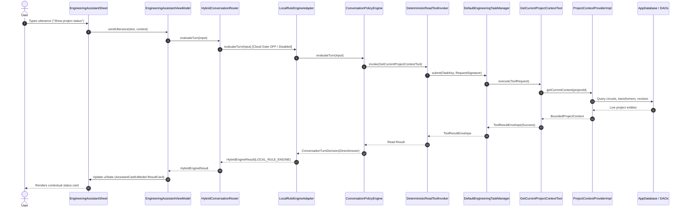
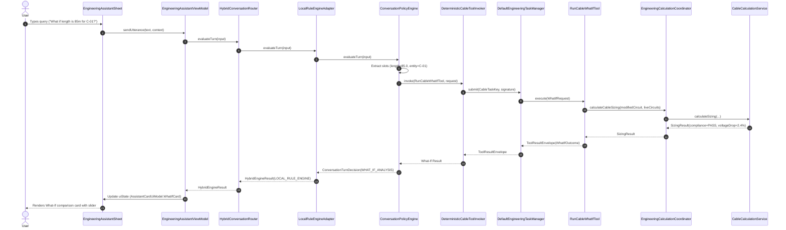
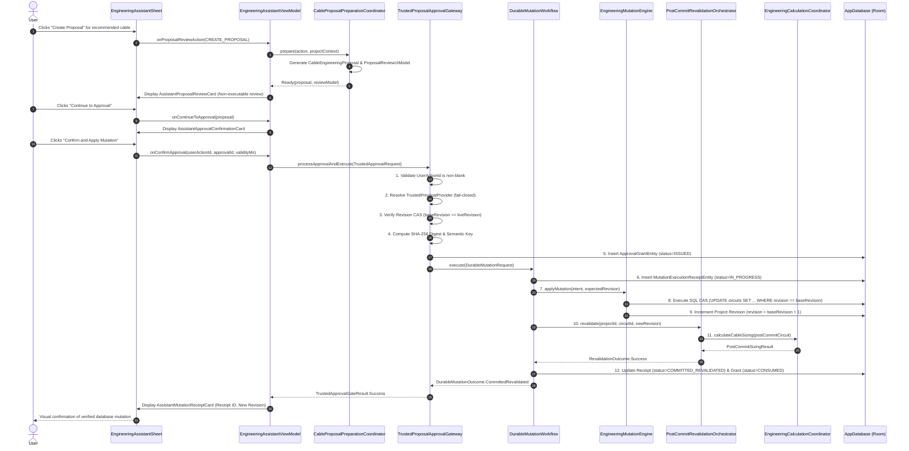

# 05: AI End-to-End Wiring Trace & Flow Diagrams

This document illustrates the exact runtime call graph traces for all four primary flows.

---

## 1. Diagram 1: Current Read-Only Assistant Flow



---

## 2. Diagram 2: Current Deterministic Calculation / What-If Tool Flow



---

## 3. Diagram 3: Current Proposal / Approval / Mutation / Revalidation Flow



---

## 4. Diagram 4: Intended Target Flow from Official Plan (Cloud Function Proxy)

```mermaid
sequenceDiagram
    autonumber
    actor User
    participant Sheet as EngineeringAssistantSheet
    participant VM as EngineeringAssistantViewModel
    participant Router as HybridConversationRouter
    participant CloudEngine as CloudLlmConversationEngine
    participant FirebaseProxy as Backend Firebase AI Logic Proxy
    participant GeminiModel as Gemini 2.5 Flash (Google Cloud)
    participant ToolBridge as Tool Execution Bridge
    participant Coordinator as EngineeringCalculationCoordinator
    participant Gateway as TrustedProposalApprovalGateway

    User->>Sheet: Freeform engineering query
    Sheet->>VM: sendUtterance(text, context)
    VM->>Router: evaluateTurn(input)
    Router->>CloudEngine: evaluateTurn(input) [Cloud Gate ON]
    CloudEngine->>FirebaseProxy: HTTPS POST (Encrypted Layer D Context + Utterance + Tool Declarations)
    Note over CloudEngine,FirebaseProxy: Zero client API key in APK; authenticated via Firebase App Check
    FirebaseProxy->>GeminiModel: generateContent with Function Calling
    GeminiModel-->>FirebaseProxy: Tool Call: calculate_cable_sizing(circuitId=101, length=120)
    FirebaseProxy-->>CloudEngine: Tool Call Request
    CloudEngine->>ToolBridge: Execute Deterministic Tool
    ToolBridge->>Coordinator: calculateCableSizing(...)
    Coordinator-->>ToolBridge: Authoritative Sizing Result
    ToolBridge-->>CloudEngine: Deterministic Tool Output
    CloudEngine->>FirebaseProxy: HTTPS POST (Tool Output Result)
    FirebaseProxy->>GeminiModel: generateContent with Tool Output
    GeminiModel-->>FirebaseProxy: Conversational Synthesis + Proposal Intent
    FirebaseProxy-->>CloudEngine: Final Synthesized Response + Proposal Spec
    CloudEngine->>CloudEngine: EngineeringClaimGuard (Verify synthesis matches tool output)
    CloudEngine-->>Router: HybridEngineResult(CLOUD_GEMINI)
    Router-->>VM: HybridEngineResult
    VM->>Sheet: Render Synthesized Explanation + Proposal Review Card
    Note over Sheet,Gateway: Proposal Mutation continues exclusively via Trusted Approval Gateway
```
